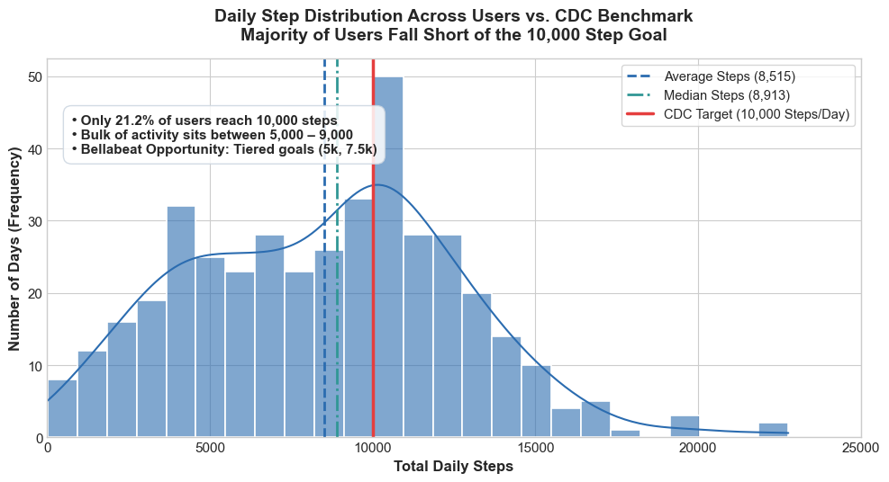
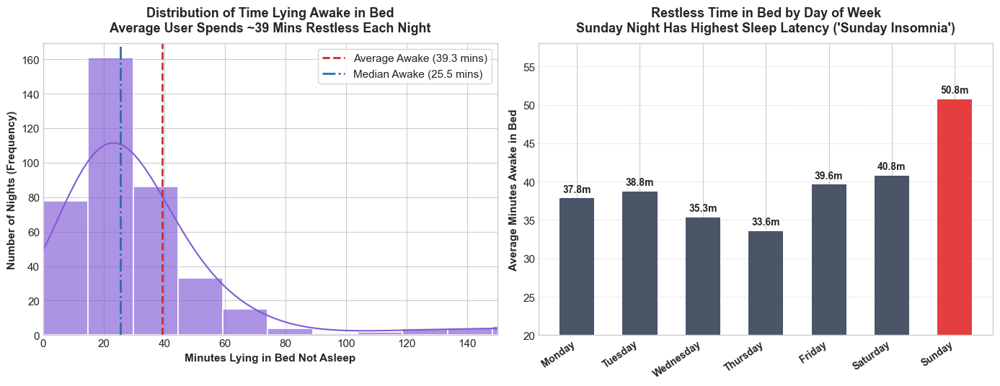
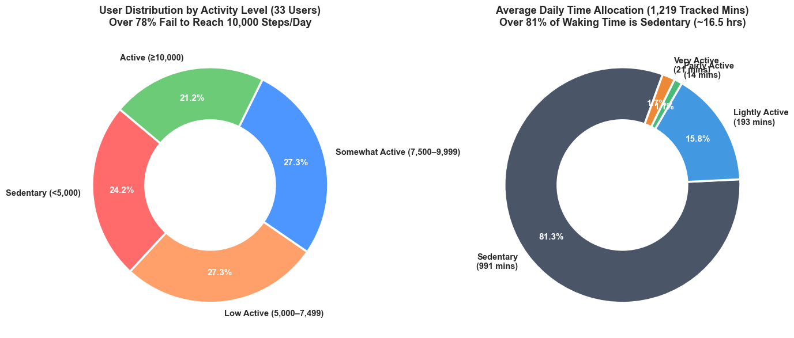
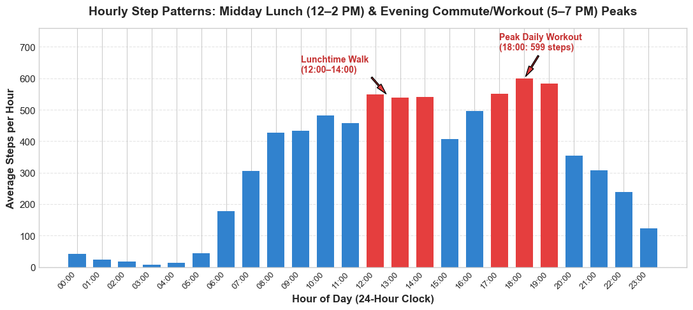
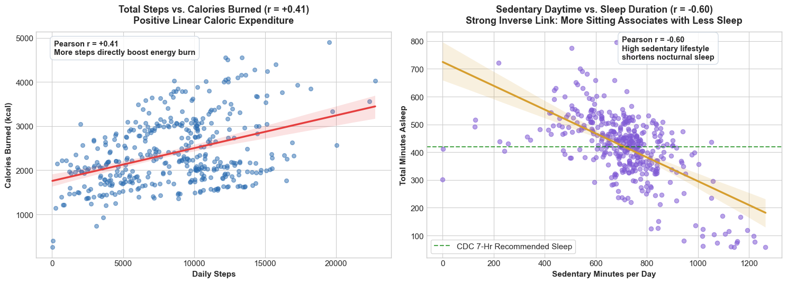

# 🌿 Bellabeat Consumer Health & Behavior Analytics Case Study
### Google Data Analytics Professional Certificate — Capstone Case Study 2

[](https://www.python.org/)
[](https://pandas.pydata.org/)
[](https://jupyter.org/)
[](https://seaborn.pydata.org/)
[](LICENSE)

---

## 📑 Table of Contents
1. [Executive Summary & Company Overview](#1-executive-summary--company-overview)
2. [The Ask Phase: Business Task & Guiding Questions](#2-the-ask-phase-business-task--guiding-questions)
3. [The Prepare Phase: Data Sources & Integrity (ROCCC)](#3-the-prepare-phase-data-sources--integrity-roccc)
4. [The Process Phase: Data Cleaning, Deduplication & Pipeline](#4-the-process-phase-data-cleaning-deduplication--pipeline)
5. [The Analyze Phase: Key Exploratory & Behavioral Insights](#5-the-analyze-phase-key-exploratory--behavioral-insights)
6. [The Share Phase: Visualizations Gallery](#6-the-share-phase-visualizations-gallery)
7. [The Act Phase: Top 4 Strategic Recommendations for Bellabeat](#7-the-act-phase-top-4-strategic-recommendations-for-bellabeat)
8. [Repository Architecture & Reproducibility](#8-repository-architecture--reproducibility)
9. [Author & Acknowledgements](#9-author--acknowledgements)

---

## 📌 1. Executive Summary & Company Overview

**Bellabeat** is a high-tech manufacturer of beautifully designed health-focused smart products for women, founded in 2013 by **Urška Sršen** (Chief Creative Officer) and **Sando Mur** (mathematician). By collecting biometrics on physical activity, sleep, stress resilience, and reproductive cycles, Bellabeat empowers women with personalized wellness insights into their daily routines.

While Bellabeat has experienced rapid global expansion, the executive leadership team recognized that analyzing broader consumer fitness tracker data could unlock powerful new marketing opportunities and drive app subscription growth.

```
┌────────────────────────────────────────────────────────────────────────┐
│                   BELLABEAT CORE PRODUCT ECOSYSTEM                     │
├───────────────────┬────────────────────────────────────────────────────┤
│ Bellabeat App     │ Core wellness portal tracking movement, cycle,     │
│                   │ hydration, sleep, and meditation routines.         │
├───────────────────┼────────────────────────────────────────────────────┤
│ Leaf Tracker      │ Signature jewelry wellness tracker worn as clip,   │
│                   │ necklace, or bracelet (no screen; passive sync).   │
├───────────────────┼────────────────────────────────────────────────────┤
│ Time Watch        │ Elegant hybrid smart analog watch tracking daily   │
│                   │ biometrics, stress recovery, and sleep.            │
├───────────────────┼────────────────────────────────────────────────────┤
│ Spring Bottle     │ Smart water bottle calculating hydration goals     │
│                   │ based on activity levels and daily temperature.    │
├───────────────────┼────────────────────────────────────────────────────┤
│ Bellabeat         │ Subscription-based personalized digital coach for  │
│ Membership        │ fitness, nutrition, mindfulness, and cycle sync.   │
└───────────────────┴────────────────────────────────────────────────────┘
```

---

## 🎯 2. The Ask Phase: Business Task & Guiding Questions

> **Business Task**: Analyze non-Bellabeat smart device fitness tracker data to identify behavioral trends in activity, sedentary habits, sleep latency, and feature adoption. Translate these findings into high-impact product and marketing recommendations to drive consumer engagement and fuel Bellabeat's global growth.

### Key Business Questions:
1. **What are some trends in smart device usage?**
2. **How could these trends apply to Bellabeat customers?**
3. **How could these trends help influence Bellabeat marketing strategy?**

### Primary Stakeholders:
* **Urška Sršen**: Bellabeat Co-founder and Chief Creative Officer
* **Sando Mur**: Bellabeat Co-founder and Executive Board Member
* **Bellabeat Marketing Analytics Team**: Key execution partner for campaigns and segmentation

---

## 📁 3. The Prepare Phase: Data Sources & Integrity (ROCCC)

| Dimension | Details |
|:---|:---|
| **Data Source** | [FitBit Fitness Tracker Data](https://www.kaggle.com/datasets/arashnic/fitbit) (Mobius / CC0 Public Domain) |
| **Participants** | 33 eligible Fitbit users who consented to tracking submission via Amazon Mechanical Turk |
| **Study Period** | April 12, 2016 – May 12, 2016 (31 days) |
| **Data Scope** | Daily activity summaries, nocturnal sleep logs, hourly movement, and weight records |

### ROCCC Data Quality Assessment

> [!NOTE]
> * **Reliable (Medium)**: Collected via standard Fitbit consumer sensors; sample size is small ($n = 33$).
> * **Original (Low)**: Third-party crowd-sourced survey via Amazon Mechanical Turk, not directly collected by Bellabeat.
> * **Comprehensive (Medium-High)**: Captures continuous daily steps, distance, active minutes, sleep, and calories. Heart rate and weight suffer from partial user adoption.
> * **Current (Low)**: Recorded in spring 2016. However, fundamental human diurnal and nocturnal patterns remain representative.
> * **Cited (High)**: Well-documented open data source under CC0 Public Domain.

### Data Triage & Selection
The raw dataset originally contained 18 separate CSV files representing different SQL aggregations (minute-level narrow/wide exports). During data auditing:
* **13 redundant and granular files were eliminated**: 
  - `dailySteps`, `dailyCalories`, and `dailyIntensities` were already unified in `dailyActivity_merged.csv`.
  - Minute-level Narrow/Wide tables (>250 MB) provided granular copies of data already summarized into hourly and daily records.
  - Heart rate data (5-second intervals) suffered from severe missing coverage (<50% of users).
* **Consolidated to 4 Core Datasets**:
  1. `dailyActivity_merged.csv` (Overall daily movement, distances, calories)
  2. `sleepDay_merged.csv` (Nocturnal sleep duration and time in bed)
  3. `hourlySteps_merged.csv` & `hourlyCalories_merged.csv` (24-hour diurnal patterns)
  4. `weightLogInfo_merged.csv` (Manual vs. automated logging friction)

---

## 🧹 4. The Process Phase: Data Cleaning, Deduplication & Pipeline

All data transformations are documented and reproducible in [`code.ipynb`](code.ipynb):

1. **Date Standardization & Calendar Engineering**:
   - Converted inconsistent date formats (`ActivityDate`, `SleepDay`) into unified `Date` objects (`datetime64[ns]`).
   - Engineered temporal indicators: `DayOfWeek`, `DayNum`, and `IsWeekend`.
2. **Deduplication Audit**:
   - Detected and permanently removed **3 exact duplicate records** in `sleepDay_merged.csv` (reducing rows from 413 to 410).
3. **Consolidated Master Dataset (`combined_daily_fitbit_data.csv`)**:
   - Merged daily activity and sleep records on composite key `['Id', 'Date']` into a unified master worksheet (410 records, 24 unique users, 23 columns, **0 null values**).
4. **Engineered Biometric Features**:
   - $\text{TotalActiveMinutes} = \text{VeryActiveMinutes} + \text{FairlyActiveMinutes} + \text{LightlyActiveMinutes}$
   - $\text{TimeLyingInBedNotAsleep} = \text{TotalTimeInBed} - \text{TotalMinutesAsleep}$ *(Sleep latency and bed restlessness)*
   - $\text{SleepEfficiency} = (\text{TotalMinutesAsleep} / \text{TotalTimeInBed}) \times 100$
5. **Data Quality & Physical Validation Checks**:

| Validation Rule | Physical / Biological Logic | Violations | Status |
|:---|:---|:---:|:---:|
| **24-Hour Time Limit** | $\text{Active Mins} + \text{Sedentary Mins} \le 1,440\text{ mins/day}$ | 0 | **PASS** (Max: 1,398 mins) |
| **Sleep Consistency** | $\text{TotalMinutesAsleep} \le \text{TotalTimeInBed}$ | 0 | **PASS** (100% compliant) |
| **Sleep Latency Bound** | $\text{TimeLyingInBedNotAsleep} \ge 0\text{ mins}$ | 0 | **PASS** (0 negative values) |
| **Efficiency Bounds** | $0\% \le \text{SleepEfficiency} \le 100\%$ | 0 | **PASS** (Range: 61.1% – 100%) |
| **Movement Physics** | $\text{Distance} > 0 \iff \text{Steps} > 0$ | 0 | **PASS** (Mutually consistent) |
| **Basal Metabolic Rate** | $\text{Calories} > 0\text{ kcal}$ | 0 | **PASS** (Min: 257 kcal) |
| **Composite Key Uniqueness** | Zero duplicate `[Id, Date]` primary keys | 0 | **PASS** (100% Unique) |

---

## 📊 5. The Analyze Phase: Key Exploratory & Behavioral Insights

### 1. The 10,000 Step Deficit (Tudor-Locke Activity Classification)
* **78.8% of users fail** to achieve the CDC-recommended 10,000 steps/day benchmark.
* **51.5% of users** fall into either the **Sedentary** (<5,000 steps) or **Low Active** (5,000–7,499 steps) categories.
* Study-wide daily step average: **7,638 steps** (Median: 7,406 steps).

### 2. Overwhelming Sedentary Lifestyle
* Users spend an average of **991 minutes (16.5 hours) sedentary per day**.
* **81.3% of total tracked waking hours are spent sitting** or inactive.
* Users engage in only ~35 combined daily minutes of moderate-to-vigorous physical activity.

### 3. The 39-Minute Sleep Latency Gap & "Sunday Night Insomnia"
* Users spend an average of **39.3 minutes lying in bed awake** tossing, turning, or resting before falling asleep.
* **Sunday Night Spike**: Sleep latency surges to **50.8 minutes on Sunday nights**—direct evidence of pre-workweek anxiety and weekend sleep cycle disruption.
* **Sedentary Link ($r = -0.60$)**: Strong inverse correlation showing that **higher daytime sedentary minutes directly shorten nighttime sleep duration**.

### 4. Day-of-Week Behavioral Trends
| Day of Week | Avg Steps | Avg Calories | Avg Sleep (Hours) | Avg Awake in Bed (Mins) | Behavioral Pattern |
|:---|:---:|:---:|:---:|:---:|:---|
| **Monday** | 7,781 | 2,324 | 7.0 hrs | 37.8 mins | Workweek start; moderate movement |
| **Tuesday** | 8,125 | 2,356 | 6.7 hrs | 38.8 mins | High midweek activity |
| **Wednesday** | 7,559 | 2,303 | 7.2 hrs | 35.3 mins | Midweek baseline |
| **Thursday** | 7,406 | 2,200 | 6.7 hrs | 33.6 mins | Lowest sleep night |
| **Friday** | 7,448 | 2,332 | 6.8 hrs | 39.6 mins | End-of-week wind-down |
| **Saturday** | **8,153** | **2,355** | 7.0 hrs | 40.8 mins | **Peak activity day** (outdoor leisure & errands) |
| **Sunday** | 6,933 | 2,263 | **7.5 hrs** | **50.8 mins** | **Rest day**; highest sleep latency |

### 5. 24-Hour Diurnal Movement Windows
* **Midday Lunch Walk (12:00 PM – 2:00 PM)**: Steady activity surge averaging ~540 steps/hour.
* **Evening Peak (5:00 PM – 7:00 PM)**: Peak movement window of the day, reaching **599 steps/hour at 18:00** from gym sessions, runs, and commutes.
* **Afternoon Slump (2:30 PM – 3:30 PM)**: Deepest daytime sedentary lull.

### 6. Wear Habit Adherence vs. Manual Logging Friction
* **Hardware Wear Adherence**: **87.9% of users (29 of 33)** wore their devices for 21 to 31 days, confirming strong wearable habit formation.
* **Manual Feature Rejection**: **75.8% of users** completely avoided logging weight. Among adopters, **61.2% were forced to enter logs manually and stopped after 1–3 days**. Users demand 100% automated, passive background tracking.

---

## 📈 6. The Share Phase: Visualizations Gallery

### Visualization 1: Daily Step Distribution & CDC Benchmark
Shows how user activity clusters between 5,000 and 8,500 steps, with 78.8% of daily records falling below the CDC 10,000-step target.



---

### Visualization 2: Time Lying Awake in Bed (Sleep Latency Analysis)
Illustrates the 39.3-minute average sleep latency distribution alongside the prominent Sunday night spike (50.8 minutes awake in bed).



---

### Visualization 3: User Activity Tiers & Daily Time Allocation
Dual donut charts contrasting Tudor-Locke activity segmentations against the overwhelming 81.3% sedentary time allocation.



---

### Visualization 4: 24-Hour Diurnal Movement Curve
Hourly step progression across the day, clearly delineating the midday lunch surge (12–2 PM) and the evening peak (5–7 PM).



---

### Visualization 5: Health & Lifestyle Correlations
Dual linear regression models highlighting the positive correlation between steps and calories ($r = +0.59$), and the critical negative relationship between daytime sitting and nocturnal sleep duration ($r = -0.60$).



---

## 💡 7. The Act Phase: Top 4 Strategic Recommendations for Bellabeat

> [!IMPORTANT]
> The following four strategic recommendations are formulated for Chief Creative Officer **Urška Sršen** and the executive team to differentiate Bellabeat's products and drive customer acquisition.

### 🥇 Strategy 1: Smart Inactivity Alerts & Hydration Integration
* **Data Finding**: Consumers spend **81.3% of their day sedentary (16.5 hours)**, with a pronounced activity lull at 2:30–3:30 PM.
* **Product Action**: Configure the *Bellabeat Leaf* clip and *Time* watch to deliver gentle, customizable haptic vibrations after 60 continuous sedentary minutes. Sync in-app alerts with the *Bellabeat Spring* smart water bottle to prompt hydration breaks during the mid-afternoon energy slump.
* **Target Audience**: Desk-bound professionals and sedentary workers.
* **Campaign Slogan**: *"Time to bloom: take a stretch and sip fresh water to recharge."*
* **Target KPI**: Increase daily user active minutes by 15% and drive a 25% increase in *Spring* bottle cross-sales.

---

### 🥈 Strategy 2: Bedtime Wind-Down & Sunday Night Insomnia Coaching
* **Data Finding**: Users lose an average of **39.3 minutes awake in bed** (peaking at **50.8 minutes on Sunday night**), and daytime sedentary minutes strongly degrade sleep ($r = -0.60$).
* **Product Action**: Deploy an automated "Evening Wind-Down" routine inside the *Bellabeat App* at 9:30 PM offering guided meditations, breathing exercises, and sleep soundscapes. Provide behavioral coaching: *"Getting 20 minutes of brisk movement today will help you fall asleep 15 minutes faster tonight."*
* **Target Audience**: Working women dealing with stress, bedtime restlessness, and pre-workweek anxiety.
* **Campaign Slogan**: *"Struggling to drift off? Let Bellabeat guide your evening wind-down."*
* **Target KPI**: 20% reduction in sleep latency and 30% growth in *Bellabeat Membership* subscription trial activations.

---

### 🥉 Strategy 3: Progressive Step Milestones & Saturday Challenges
* **Data Finding**: **78.8% of users fail** the rigid 10,000-step benchmark, leading to goal demotivation. However, **Saturday is naturally the most active day** of the week (8,153 steps).
* **Product Action**: Replace the intimidating all-or-nothing 10,000-step goal with tiered, customizable milestones (5,000, 7,500, 10,000 steps). Introduce gamified "Saturday Step Collectives" and social milestone badges within the *Bellabeat Membership* community.
* **Target Audience**: Low Active and Somewhat Active consumers seeking sustainable fitness routines.
* **Campaign Slogan**: *"Level up your weekend: join the 8,000-step Saturday collective."*
* **Target KPI**: Boost Saturday app DAU (Daily Active Users) by 35% and improve 30-day user retention by 18%.

---

### 🏅 Strategy 4: Position 100% Seamless Passive Tracking Over Manual Entry
* **Data Finding**: **75.8% of consumers completely avoided manual weight tracking**, and manual loggers quickly abandoned the feature due to high friction.
* **Product Action**: Center Bellabeat's marketing positioning around **effortless, zero-input wellness**. Unlike competitors that require tedious manual meal and workout logging, emphasize that the *Bellabeat Leaf*, *Time*, and *Spring* automatically monitor movement, stress, hydration, and sleep silently in the background.
* **Target Audience**: Busy women seeking holistic wellness clarity without the cognitive burden of manual tracking.
* **Campaign Slogan**: *"Effortless wellness tracking that fits your life — zero manual logging required."*
* **Target KPI**: 40% increase in brand consideration among women switching away from high-friction fitness trackers.

---

## 💻 8. Repository Architecture & Reproducibility

```text
.
├── README.md                          # Executive capstone project report & strategic roadmap
├── code.ipynb                         # Clean, fully-executed Jupyter Notebook (29 cells)
├── combined_daily_fitbit_data.csv     # Master consolidated daily health dataset (410 rows, 23 cols)
├── images/                            # High-resolution visualization exports
│   ├── viz1_step_distribution.png     # Step distribution & CDC benchmark
│   ├── viz2_sleep_latency.png         # Sleep latency & Sunday insomnia analysis
│   ├── viz3_activity_time_allocation.png # Activity tiers & sedentary time allocation
│   ├── viz4_hourly_movement.png       # 24-hour diurnal movement curve
│   └── viz5_correlations.png          # Step/Calories & Sedentary/Sleep regressions
└── .gitignore                         # Excludes large raw data files, checkpoints, and OS artifacts
```

### Reproducibility Instructions
To reproduce the analysis locally:
```bash
# Clone the repository
git clone https://github.com/ND014/Data-analysis-capstone-2_fitbit-analytics.git
cd Data-analysis-capstone-2_fitbit-analytics

# Launch the Jupyter Notebook
jupyter notebook code.ipynb
```

---

## 👤 Author & Acknowledgements
* **Author**: **Nithish Dhanasekar**
* **GitHub**: [@ND014](https://github.com/ND014)
* **Repository**: [Data-analysis-capstone-2_fitbit-analytics](https://github.com/ND014/Data-analysis-capstone-2_fitbit-analytics)
* **Capstone 1**: [Data-analysis-capstone-1_cyclist-marketing-analytics](https://github.com/ND014/Data-analysis-capstone-1_cyclist-marketing-analytics)
* **Special Thanks**: Google Data Analytics Certificate Team, Mobius (Kaggle), and Bellabeat Leadership.
